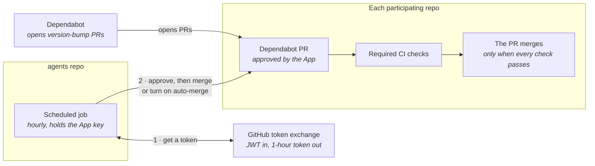
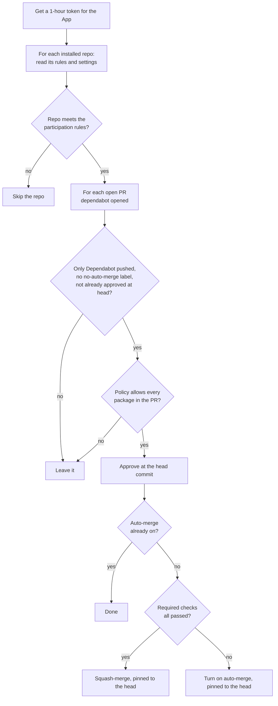
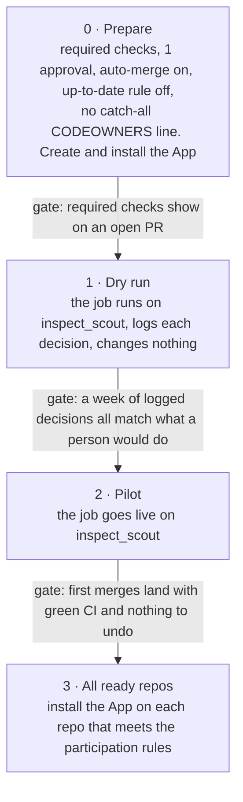

# Dependabot merge job

Status: accepted (Eric, 2026-11-10). Implemented in the same PR as this
document, running dry: it logs what it would do and writes nothing.

## Goal

Routine Dependabot version bumps across Meridian repos merge without a
person, once the repo's required CI checks pass. One scheduled job in this
repo does it for every participating repo, so no repo needs its own workflow
file or config to take part. A bump merges only when the merge policy allows
it and the required checks pass. Anything else stays open for a person.

Out of scope: the security-alert PRs that ts-mono's `dependabot-fix` workflow
opens, GitHub Actions bumps (see [Identity](#identity-and-credentials)), and
inspect_ai on UKGovernmentBEIS.

## How it fits together



The job approves a PR, then merges it if the repo's required checks have
already passed. If they are still running, it turns on GitHub's auto-merge
instead, and GitHub merges when they pass. GitHub refuses auto-merge on a PR
that can already merge, which is why the job needs both paths. Either way,
nothing merges until the required checks pass. If a check never passes, the
PR stays open for a person. The job never updates a branch.

## Each run



**Participation rules.** On every run the job reads each repo's default
branch rules and settings, and skips the whole repo when any of these holds:

- No required status checks. Without them a PR could merge the moment it
  opens, before CI has run.
- No required approval.
- The approval rule neither dismisses stale approvals nor requires approval
  of the most recent push. Otherwise the App's approval would still count
  after someone else pushed.
- Allow auto-merge or squash merging is off, so a merge would fail after the
  approval.

**PR rules.** A PR is left alone when:

- Anyone but `dependabot[bot]` pushed to its branch, by GitHub's record of
  pushes to the branch, or its head moved while the job read it. Who a commit
  is credited to is not enough, because someone with write access can push a
  commit credited to Dependabot.
- It carries the `no-auto-merge` label.
- The App has already approved its current head.
- The merge policy doesn't allow every package it updates.

Running the job twice does no harm. A PR the App has already approved at its
current head is left as it is. If a later push cancels that approval, for
example when Dependabot rebases the PR after another bump merges, the next
run approves it again and leaves auto-merge as it is.

## Identity and credentials

The job acts as a GitHub App, `meridian-dependabot-merger`, not as a person
and not as Marvin. If its key leaks, the damage stays within this one job, on
the installed repos only.

| App permission | Level | Why it's needed |
| --- | --- | --- |
| Metadata | Read | Required by GitHub for every App |
| Pull requests | Write | List Dependabot PRs, approve them, merge them and turn on auto-merge |
| Contents | Write | Needed for a merge to write to the default branch |
| Workflows | None | See below |

GitHub won't merge a PR that changes `.github/workflows/` without Workflows:
write, and every GitHub Actions bump changes those files. That permission is
the riskiest one: a stolen token could change workflow files, and workflows
can read a repo's secrets. So the App doesn't have it, and people merge
GitHub Actions bumps by hand. Most repos batch those into one PR a week.

The check-run and commit-status reads work without Checks or Commit statuses
permissions only because every participating repo is public. A private repo
needs both, read-only.

**Approvals.** Every Meridian repo requires 1 approval, with the Meridian team
on the ruleset's bypass list. The App is on no bypass list, because a bypass
skips every rule in the ruleset, required checks included. Instead the job
approves each PR that passes its rules, and that approval meets the 1-approval
rule. So the App's token can approve PRs: anyone holding it could approve and
merge a branch they pushed, as long as its required checks pass. That is the
main reason the key is restricted to `main`. Files with a code owner still
wait for that person, because the App's approval doesn't count as a code
owner's.

**Tokens.** At the start of each run the job exchanges the App's private key
for an installation token. The token lasts one hour, covers only the installed
repos, and carries only the permissions above.

**The key.** The private key is the secret `DEPENDABOT_MERGER_PRIVATE_KEY` in
this repo's `dependabot-merger` environment, which only the `main` branch can
use, so a workflow on any other branch can't read it. The App ID is the
environment variable `DEPENDABOT_MERGER_APP_ID`. To revoke the job's access,
delete the App's private key or uninstall the App.

**Never install the App on agents.** The job's own dependencies live here
(PyYAML, from `uv.lock`), so it would approve and merge bumps of the code it
runs with that token.

### Creating the App

A Meridian org owner does this once:

1. Create the App at
   `https://github.com/organizations/meridianlabs-ai/settings/apps/new`:
   name `meridian-dependabot-merger`, homepage
   `https://github.com/meridianlabs-ai/agents`, webhook **Active** unchecked,
   the repository permissions in the table above and nothing else,
   installable **Only on this account**.
2. Note the App ID, and generate a private key.
3. Install the App on the participating repos only, with **Only select
   repositories**.
4. In agents, create the environment `dependabot-merger`, limit its
   deployment branches to `main`, and add the secret and variable named under
   [The key](#identity-and-credentials).
5. Delete the local `.pem`. A backup copy goes in 1Password, never in Slack
   or email.
6. Don't add the App to any ruleset's bypass list.

## Merge policy

The policy file, `.github/dependabot-merge-policy.yml`, sets which bump types
may merge for each dependency type, and lists packages that always wait for a
person:

```yaml
# Which Dependabot bumps the job may auto-merge.
# A dependency type left out here never auto-merges.
allow:
  uv:             [patch, minor, major]
  pip:            [patch, minor, major]
  npm_and_yarn:   [patch, minor, major]
  # github_actions waits for a person until the App has Workflows: write.
  # github_actions: [patch, minor, major]

# Packages that always wait for a person, whatever the bump.
always_ask: []
```

Every bump type merges for Python and npm. To make major bumps wait for a
person in every repo, change `[patch, minor, major]` to `[patch, minor]`. To
hold back one package, add its name to `always_ask`.

**How the job reads a PR.** The dependency type comes from Dependabot's branch
name, such as `dependabot/uv/...`. The bump type comes from the
`updated-dependencies` block in Dependabot's commit messages, such as
`update-type: version-update:semver-minor`, the same places the
`dependabot/fetch-metadata` action reads. A grouped PR merges only if every
package in it is allowed.

**Opting a PR out.** `no-auto-merge` is an ordinary repo label; GitHub has no
built-in equivalent. The job creates it in each repo it serves. To stop a
Dependabot PR merging on its own, for example before a release or when the
new version is known to break something:

1. Add the `no-auto-merge` label. If auto-merge is already on, also turn it
   off on the PR.
2. Every later run skips the PR, so the job never turns auto-merge back on.
3. To hand the PR back, remove the label. The next hourly run picks it up.

The label is needed because turning auto-merge off by hand lasts only until
the next run. Closing the PR, or commenting `@dependabot ignore this version`,
also works and needs no label.

**Cooldown.** Each repo's `dependabot.yml` sets a `cooldown`, so Dependabot
only proposes releases that are some days old. Dependabot's cooldown counts
whole days, so a repo that wants a shorter wait for a fast-moving package
leaves it out of the Dependabot cooldown and enforces the wait elsewhere.
inspect_scout, for example, gives anthropic, google-genai, openai and
inspect-swe a 6-hour cooldown through uv's `exclude-newer-package`. To make
such a package wait for a person instead, add it to `always_ask`.

## Rollout



**Going live** is one reviewed change to the workflow: add `--live` to the
run step, and mint the token with `permission-pull-requests: write` and
`permission-contents: write`. Until then the script runs without `--live`,
and the token is minted read-only.

"Require branches to be up to date" must stay off in participating repos.
With it on, every merge puts the other open PRs behind main, and the job
would have to update each one and wait for CI again. That update would also
add a commit that isn't Dependabot's.

## Failure handling

Kept to the minimum on purpose. A PR whose required checks fail stays open
with auto-merge on, and a person sees the red check. A failed PR or repo is
logged as an error and fails the run. There are no retries, alerts or
dashboard; add one only when a real failure shows it's needed.
